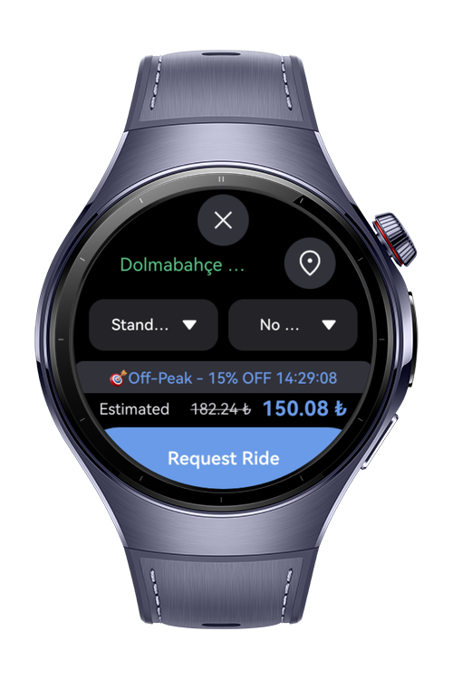
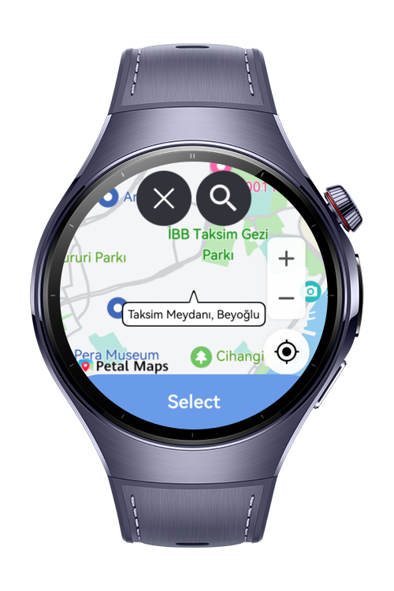
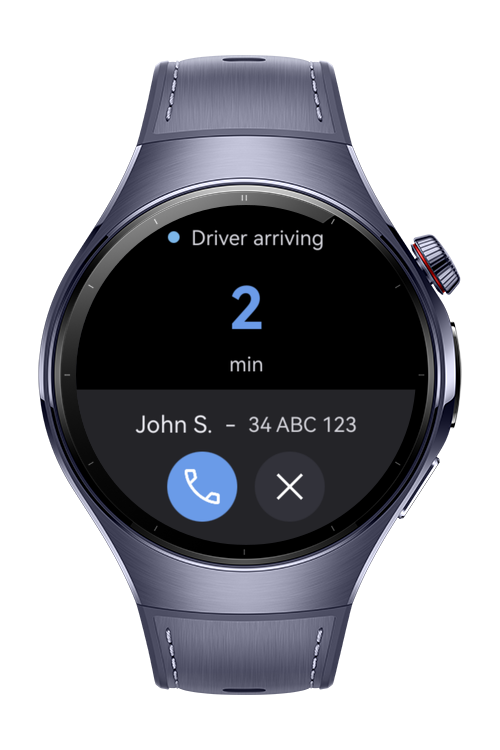
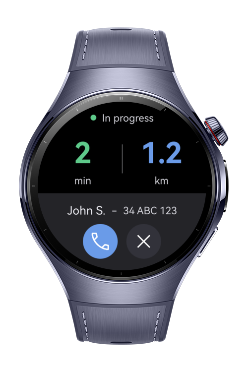

> **Note:** To access all shared projects, get information about environment setup, and view other guides, please visit [Explore-In-HMOS-Wearable Index](https://github.com/Explore-In-HMOS-Wearable/hmos-index).

# Wearable City Taxi
City Taxi is a standalone wearable application that helps you to make easier the organization for going somewhere else in the city.

# Preview
<div>
  
  
  
  
</div>

# Use Cases
- Request a taxi from saved addresses or the map
- Display recent trips
- Save addresses for quick taxi calls
- Choose vehicle types
- Provide discount coupons and campaigns
- Call the taxi driver by phone
- Cancel a taxi trip
- Rate the taxi driver
- Estimate trip price
- Display remaining trip distance

# Technology
## Stack

**Languages**: ArkTS, ArkUI  
**Frameworks**: HarmonyOS SDK 6.0.1  
**Tools**: DevEco Studio 6.0.1  
**Libraries/Kits**:
- @kit.MapKit
- @ohos/lottie
- @kit.NotificationKit
- @kit.AbilityKit
- @ohos.vibrator
- @kit.BasicServicesKit
- @kit.TelephonyKit
- @kit.ArkData
- @kit.PerformanceAnalysisKit
- @kit.CoreFileKit
- @kit.SensorServiceKit
- @ohos.geoLocationManager

## Required Permissions
- `ohos.permission.INTERNET`
- `ohos.permission.GET_NETWORK_INFO`
- `ohos.permission.LOCATION`
- `ohos.permission.APPROXIMATELY_LOCATION`
- `ohos.permission.VIBRATE`
- Mapkit permission from AGC

# Directory Structure
```
./entry/src/main/ets
├───api
│       MockApi.ets
│       MockApiImpl.ets
├───common
│   ├───components
│   │       AppButton.ets
│   │       AppLottie.ets
│   │       AppText.ets
│   │       BubbleText.ets
│   │       PoiCard.ets
│   │       SearchInput.ets
│   ├───constants
│   │       UIConstants.ets
│   ├───models
│   │       AddressModel.ets
│   │       PricingModel.ets
│   │       Ride.ets
│   │       RideModel.ets
│   ├───services
│   │       CallService.ets
│   │       CampaignService.ets
│   │       CouponService.ets
│   │       NotificationService.ets
│   │       PricingService.ets
│   │       RideHelper.ets
│   └───viewmodel
│           RideViewModel.ets
├───database
│   │   AppDatabase.ets
│   │   AppDatabaseImpl.ets
│   │   RdbMappers.ets
│   └───tables
│           OldTripsTable.ets
│           SavedDestinationTable.ets
├───di
│       MainRegistry.ets
├───entryability
│       EntryAbility.ets
├───entrybackupability
│       EntryBackupAbility.ets
├───myabilitystage
│       MyAbilityStage.ets
├───pages
│   ├───map
│   │       AddressSelectionFromMap.ets
│   └───taxihome
│           CompletedView.ets
│           DriverArrivingView.ets
│           DriverInfoPanel.ets
│           FindingDriverView.ets
│           InProgressView.ets
│           LocationPickingView.ets
│           NoRideView.ets
│           StatusIndicator.ets
│           TaxiHome.ets
│       AddAddressPage.ets
│       AddressSearchPage.ets
│       AddressSelectionFromMapPage.ets
│       Index.ets
│       OldTripsPage.ets
│       SavedAddressesPage.ets
├───registry
│       Injectable.ts
│       ServiceRegistry.ts
│       UIRegistry.ts
```

# Constraints and Restrictions
## Supported Devices
- Huawei Watch 5
- DevEco Studio Emulator

## Limitations

- Users need to apply location permissions and enable location in smart watch
- Reverse geocoding is not supported in emulator

# LICENSE

**Wearable City Taxi** is distributed under the terms of the MIT License.
See the [LICENSE](/LICENSE) for more information.